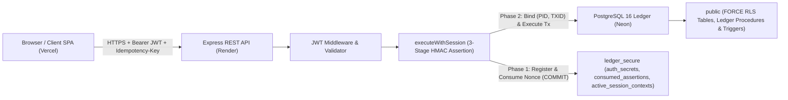
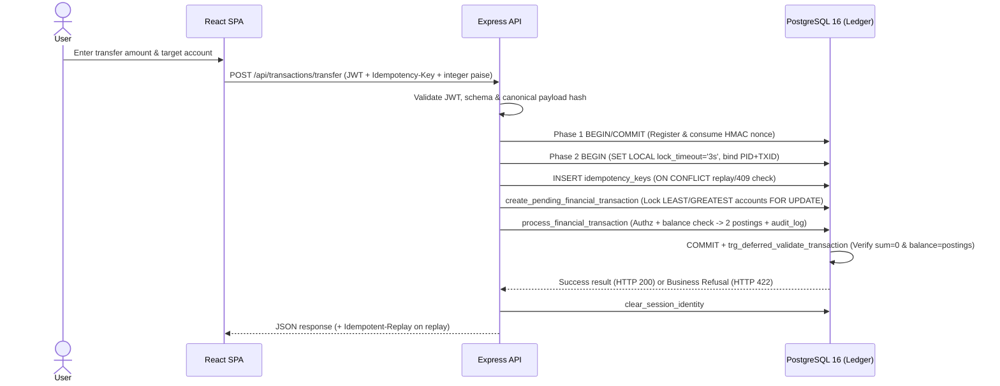
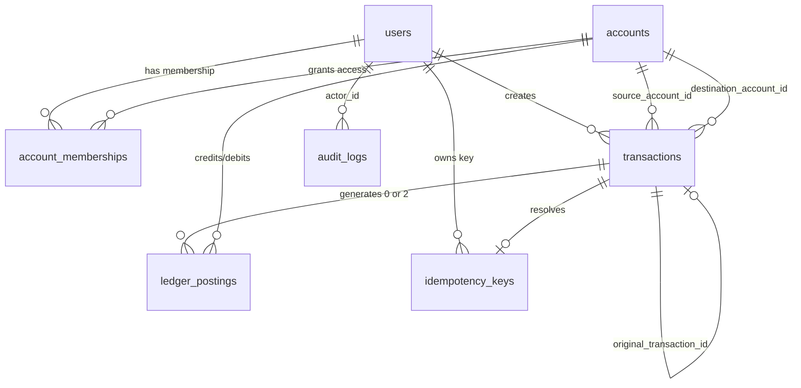

# LedgerLine — Money Movement with a Ledger You Can Prove

[](https://nodejs.org/)
[](https://expressjs.com/)
[](https://react.dev/)
[](https://vite.dev/)
[](https://tailwindcss.com/)
[](https://www.postgresql.org/)
[-2EA44F)](#12-testing-and-cicd)

**LedgerLine** is a full-stack double-entry financial transaction engine and management platform built around database-enforced accounting invariants, deterministic concurrency control, and PostgreSQL Row-Level Security (`FORCE RLS`).

---

## Table of Contents

1. [Project Overview](#1-project-overview)
2. [Live Deployment](#2-live-deployment)
3. [Features](#3-features)
4. [Technology Stack](#4-technology-stack)
5. [System Architecture](#5-system-architecture)
6. [Financial Transaction Workflow](#6-financial-transaction-workflow)
7. [Database Design](#7-database-design)
8. [Security Architecture](#8-security-architecture)
9. [API Documentation](#9-api-documentation)
10. [Project Structure](#10-project-structure)
11. [Installation and Local Setup](#11-installation-and-local-setup)
12. [Testing and CI/CD](#12-testing-and-cicd)
13. [Deployment Architecture](#13-deployment-architecture)
14. [Demo Walkthrough](#14-demo-walkthrough)
15. [Limitations and Future Enhancements](#15-limitations-and-future-enhancements)
16. [Contributors and Acknowledgements](#16-contributors-and-acknowledgements)

---

## 1. Project Overview

### What LedgerLine Does
LedgerLine enables authenticated customers, account auditors, and platform administrators to open INR ledger accounts, manage account memberships, execute deposits, withdrawals, peer-to-peer transfers, and administrative reversals, and audit every money movement through a verifiable double-entry posting history.

### Problem Statement & Motivation
Conventional web applications often implement balance checks and ledger updates purely inside application-layer code using floating-point numbers (`Number`) and ad-hoc `UPDATE accounts SET balance = balance - amount` queries. Under concurrency, network retries, or compromised application queries, that pattern invites:
- **IEEE 754 binary rounding drift** (e.g., `0.1 + 0.2 !== 0.3`).
- **Race-condition overdraws and deadlocks** when parallel transfers read stale balances or lock accounts in conflicting orders.
- **Unreconciled partial state** when a failure commits a balance update without a matching journal entry (or vice versa).
- **Multi-tenant data leakage** if an application query misses a `WHERE user_id = ...` filter.

### Objectives & What Makes LedgerLine Different
Instead of trusting only application handlers, LedgerLine pushes mathematical and access-control invariants into **PostgreSQL 16 triggers, constraints, `SECURITY DEFINER` stored procedures, and `FORCE ROW LEVEL SECURITY`**:
- **Double-entry proof at commit:** A `DEFERRABLE INITIALLY DEFERRED` constraint trigger verifies at `COMMIT` that every `posted` transaction has exactly 2 complementary postings (`1 DEBIT`, `1 CREDIT`, summing to `0`) and that cached account balances equal `SUM(signed_amount_paise)`. Refused transactions (`INSUFFICIENT_FUNDS`, frozen/closed accounts) record `status = 'refused'` with strictly `0` postings.
- **Three-stage anti-replay identity lifecycle:** Database session identity is authenticated via short-lived HMAC-SHA256 assertions committed independently *before* financial execution, so replaying an assertion is impossible even after a financial rollback.
- **Zero-overdraw concurrency safety:** Parallel transfers lock accounts in ascending UUID order (`LEAST(src, dest)` then `GREATEST(src, dest)`) with bounded lock timeouts (`3s`), eliminating opposite-direction deadlocks while serializing concurrent debits.

---

## 2. Live Deployment

| Component | Environment / Host | URL / Provider |
| :--- | :--- | :--- |
| **Frontend Web App** | Vercel | <https://ledgerline-core.vercel.app> |
| **Backend REST API** | Render (Web Service) | <https://ledgerline-api-gxy5.onrender.com> |
| **Database** | Neon | Managed PostgreSQL 16 (`DB_SSL=true`) |

> **Hosting Note:** The backend API is currently deployed on **Render's free hosting tier**. After periods of inactivity, the API instance spins down and may experience **cold starts** (an initial delay on the first wake-up request or `/api/health` check).

---

## 3. Features

- **User Registration & Authentication:** Self-service customer registration (`POST /api/auth/register`) and login (`POST /api/auth/login`) using per-user salted `scrypt` password hashes and HS256 JWT bearer tokens.
- **Account Creation & Lifecycle Management:** Authenticated creation of INR customer accounts (`POST /api/accounts`), automatic `account_holder` membership binding, and account status management (`active`, `frozen`, `closed` — enforcing zero-balance checks before closure).
- **Double-Entry Money Movement:**
  - **Deposits:** Transfers funds from `SYSTEM_CASH_VAULT` to a customer account.
  - **Withdrawals:** Transfers funds from a customer account back to `SYSTEM_CASH_VAULT` with non-negative balance enforcement.
  - **Customer Transfers:** Atomic transfers between two active customer accounts.
  - **Administrative Reversals:** Compensating reversal transactions (`POST /api/transactions/:id/reverse`) that create inverse postings while prohibiting double-reversal (`uq_transactions_single_posted_reversal`).
- **Transaction History & Paginated Statements:** Inspect account statements with running postings (`GET /api/accounts/:id/statement`) and individual transaction breakdowns showing exact `DEBIT` and `CREDIT` postings (`GET /api/transactions/:id`).
- **Idempotency & Duplicate-Request Protection:** Mandatory `Idempotency-Key` / `x-idempotency-key` header on financial writes with canonical JSON SHA-256 payload hashing; identical retries return cached responses (`Idempotent-Replay: true`), while conflicting payloads or active races return `HTTP 409`.
- **Role-Based Access Control (RBAC) & Shared Accounts:**
  - **User roles:** `customer` and `admin`.
  - **Account membership roles:** `account_holder` (read + financial operations + membership/status controls) and `auditor` (strictly read-only access to explicitly assigned accounts and statements).
- **Administrator & Auditor Capabilities:** Administrators can inspect accounts/transactions/audit context globally via `FORCE RLS` admin predicates, reverse posted transactions, and suspend/reactivate users (`PATCH /api/auth/status`); auditors can review authorized accounts and statements without initiating writes.
- **Immutable Audit Logging:** Critical actions (`TRANSACTION_POSTED`, `TRANSACTION_REFUSED`, `TRANSACTION_REVERSED`, user/account/membership updates) are recorded in `public.audit_logs`, protected against `UPDATE` and `DELETE` by triggers.
- **Financial Integrity Validation:** Client-side string-splitting minor-unit math (`rupeesToPaise`), server-side `BIGINT` range validation (`validateAmountPaise`), and database commit-time invariant verification.

---

## 4. Technology Stack

| Category | Technologies | Why It Is Used |
| :--- | :--- | :--- |
| **Frontend** | React 18, Vite 5.4, Tailwind CSS v4 (`@tailwindcss/vite`), React Router v7, Lucide Icons | Component-driven SPA UI, fast Vite production bundling, utility-first responsive styling, protected client routing, and lightweight icon set. |
| **Backend** | Node.js 24.x (ES Modules), Express 4.21, `pg` (`node-postgres`), `dotenv` | Modern JavaScript runtime parity across API/scripts, minimal explicit REST middleware pipeline, parameterized PostgreSQL driver with pool & TLS controls. |
| **Database** | PostgreSQL 16 (Neon), PL/pgSQL procedures & triggers, `pgcrypto` | Enforces ACID transactions, deterministic row locking (`FOR UPDATE`), `BIGINT` arithmetic, `FORCE RLS`, deferred commit validation, and cryptographic helpers inside the engine. |
| **Authentication & Security** | HS256 JWT (`crypto`), `crypto.scrypt`, HMAC-SHA256 identity assertions, `helmet`, `cors`, PostgreSQL RLS | Stateless API bearer auth, salted password hashing at rest, non-replayable DB session verification, HTTP security headers, exact-origin CORS, and DB-level tenant isolation. |
| **Testing** | Node.js built-in test runner (`node --test`, `node:assert/strict`) | Zero-dependency native test execution across backend integration/concurrency/TLS suites (`71` tests) and frontend precision/client suites (`41` tests). |
| **CI/CD** | GitHub Actions (`ubuntu-latest`, PostgreSQL 16 service container) | Automates clean database migrations, bootstrap, backend/frontend test execution, and production Vite asset verification on pushes and PRs to `main`. |
| **Deployment & Infrastructure** | Vercel (Frontend), Render (Backend Web Service), Neon (Managed PostgreSQL 16) | Global static SPA hosting with client rewrite routing (`vercel.json`), managed Node.js API hosting, and cloud PostgreSQL with TLS verification (`DB_SSL=true`). |
| **Version Control** | Git & GitHub | Linear commit provenance, migration history tracking, and automated CI triggers. |

---

## 5. System Architecture

LedgerLine separates client presentation, API orchestration, and ledger invariants into three distinct trust boundaries:

1. **React SPA Frontend (Vercel):** Converts rupee inputs via string-splitting `BigInt` parsing (`rupeesToPaise`), attaches `Authorization: Bearer <token>` from `sessionStorage` (with in-memory fallback), generates UUID v4 `Idempotency-Key` headers for writes, and verifies ledger posting balance invariants on fetched transaction details.
2. **Express REST API (Render):** Enforces `helmet()` headers, exact single-origin `cors({ origin: env.CLIENT_ORIGIN })`, `10kb` JSON/URL-encoded body bounds, and JWT middleware (`requireAuth`, `requireRole`). For protected database operations, [`executeWithSession`](server/src/utils/sessionContext.js) wraps work inside the 3-stage HMAC assertion lifecycle.
3. **PostgreSQL 16 Ledger Engine (Neon):** The runtime API connects strictly as least-privilege role `ledgerline_app`. Security-critical mutations and reads run through `ledgerline_owner`-owned `SECURITY DEFINER` procedures under `FORCE ROW LEVEL SECURITY` (`p_owner_bypass_*` policies) and trigger validators.



---

## 6. Financial Transaction Workflow

Every financial write (`deposit`, `withdrawal`, `transfer`, `reversal`) follows a deterministic 10-step execution pipeline:

1. **Transfer Initiated:** The client UI converts human-entered rupee decimals into integer paise (`rupeesToPaise`) and sends `POST /api/transactions/transfer` (or `/api/transactions`) with `Authorization: Bearer <JWT>` and an `Idempotency-Key`.
2. **Authentication, RBAC & Input Validation:** `requireAuth` validates the HS256 JWT signature and expiry. `processTransactionRequest` rejects missing idempotency keys, non-positive/float/unsafe integers (`validateAmountPaise`), or identical source/destination accounts.
3. **Session Identity & Idempotency Reservation:** `executeWithSession` signs a 30-second HMAC-SHA256 assertion, commits its single-use nonce consumption independently (`Phase 1`), starts the financial transaction (`BEGIN`, `SET LOCAL lock_timeout = '3s'`), binds `(pg_backend_pid(), txid_current())` in `ledger_secure.active_session_contexts`, and inserts into `public.idempotency_keys` (`status = 'in_progress'`). Duplicate keys return cached responses (`Idempotent-Replay: true`) or `409 Conflict` if payload hashes differ or another request is active.
4. **Database Transaction Begins:** `create_pending_financial_transaction` is invoked inside the isolated transaction.
5. **Deterministic Account Locking:** Source and destination rows in `public.accounts` are locked in ascending UUID order (`LEAST(src, dest)` then `GREATEST(src, dest)` via `SELECT ... FOR UPDATE`) to eliminate opposite-direction deadlocks. A `pending` row is inserted into `public.transactions` and bound to the idempotency record.
6. **Authorization, Status & Balance Checks:** `process_financial_transaction` re-verifies account status (`active`), validates endpoint types, checks `account_holder` membership (unless caller is `admin`), and checks `current_balance >= amount_paise` for customer sources. Business violations (such as `INSUFFICIENT_FUNDS` or frozen accounts) invoke `record_business_refusal`, recording `status = 'refused'` (`HTTP 422`) with zero postings.
7. **Double-Entry Postings Created:** Sequence `1` (`DEBIT`, `-amount_paise`) and Sequence `2` (`CREDIT`, `+amount_paise`) rows are inserted into `public.ledger_postings`; `trg_maintain_account_balance` updates `accounts.current_balance`.
8. **Transaction Finalized & Integrity Validated:** `public.transactions` updates to `status = 'posted'`. At `COMMIT`, the deferred trigger `trg_deferred_validate_transaction` verifies 2 postings (`1 DEBIT`, `1 CREDIT`), zero net sum, exact amount/endpoint/currency matching, and cached-balance-to-postings reconciliation.
9. **Audit & Idempotency Resolution:** `idempotency_keys` transitions to `resolved` with `response_code = 200` and cached JSON `response_body`, and an immutable `TRANSACTION_POSTED` record is inserted into `public.audit_logs`.
10. **Commit or Atomic Rollback:** PostgreSQL commits atomically (or rolls back completely on constraint/trigger/overflow failure, leaving zero partial postings or balance changes while Phase-1 assertion consumption remains permanently recorded), and `clear_session_identity` cleans up the session context (discarding the pooled socket via `client.release(true)` if cleanup fails).



### Why Integer Paise & Double-Entry Accounting?
- **Integer Paise (`BIGINT`):** Storing currency in minor units (`1 INR = 100 paise`) avoids IEEE 754 binary floating-point rounding drift in core ledger addition and subtraction. PostgreSQL `BIGINT` arithmetic rejects 64-bit overflows (`SQLSTATE 22003`) atomically rather than silently wrapping. *(This eliminates binary float drift in core balance math without claiming to replace broader application validation).*
- **Double-Entry Zero-Sum Ledger:** Every posted movement records equal and opposite legs (`DEBIT` `-X`, `CREDIT` `+X`) tied to an immutable transaction header, providing an independently verifiable mathematical invariant (`SUM(signed_amount_paise) = 0`) across the entire ledger.

---

## 7. Database Design

All core tables reside in schema `public` (owned by `ledgerline_owner` with `ENABLE` + `FORCE ROW LEVEL SECURITY`), supported by three internal security tables in schema `ledger_secure` (`auth_secrets`, `consumed_assertions`, `active_session_contexts`) and migration tracking in `public._schema_migrations`.

| Table | Responsibility | Key Constraints & Relationships |
| :--- | :--- | :--- |
| **`users`** | Registered accounts (`customer`, `admin`), scrypt password hashes, active status (`is_active`). | `PK id`, `UNIQUE email`, `CHECK (role IN ('customer', 'admin'))`. |
| **`accounts`** | Customer accounts and structural `SYSTEM_CASH_VAULT`, currency (`INR`), status, cached `current_balance` (`BIGINT`). | `PK id`, `UNIQUE account_number`, `account_type` (`customer`/`system`), `current_balance >= 0` for customer accounts. |
| **`account_memberships`** | Maps users to accounts with explicit per-account permissions (`account_holder` or read-only `auditor`). | `UNIQUE (account_id, user_id)`, `FK` to `accounts` and `users`; prevents revoking the final `account_holder`. |
| **`transactions`** | Intent and lifecycle header (`pending`, `posted`, `refused`), type (`deposit`, `withdrawal`, `transfer`, `reversal`), endpoints, `refusal_reason`. | `CHECK (amount_paise > 0)`, `source != destination`, `uq_transactions_single_posted_reversal`, immutable once finalized. |
| **`ledger_postings`** | Append-only double-entry debit/credit journal rows (`sequence_number` `1` & `2`, `signed_amount_paise`). | `FK` to `transactions` & `accounts`, `UNIQUE (transaction_id, sequence_number)`, `BEFORE UPDATE/DELETE` triggers block mutations. |
| **`idempotency_keys`** | Per-user deduplication store capturing request method, path, payload hash, resolution state, and cached response body. | `UNIQUE (user_id, idempotency_key)`, `UNIQUE transaction_id`, lifecycle trigger enforces append-only request identity. |
| **`audit_logs`** | Immutable forensic trail recording verified actor ID, role, action, entity target, metadata JSONB, and timestamp. | `FK actor_id -> users`, protected against `UPDATE` and `DELETE` by `trg_append_only_audit_logs`. |



---

## 8. Security Architecture

### Implemented Protections (Verified in Source & Migrations)
- **PostgreSQL `FORCE ROW LEVEL SECURITY`:** All 7 domain tables enforce RLS even against table owners (`FORCE ROW LEVEL SECURITY` in `003_rls_helpers_and_policies.sql`). Non-login role `ledgerline_owner` has `rolbypassrls = false` and relies on explicit `TO ledgerline_owner` policies (`p_owner_bypass_*`) inside `SECURITY DEFINER` functions, while `ledgerline_app` sees only rows authorized by non-recursive helpers (`current_verified_user_id()`, `is_account_member()`, `is_account_holder()`).
- **Role-Based & Membership-Based Access Control:** Route-level `requireRole('admin')` plus DB-level checks distinguish global `admin`/`customer` roles from account-level `account_holder`/`auditor` memberships (auditors are denied all mutations; administrators have global read access and reversal/user-status authority).
- **`SECURITY DEFINER` Search-Path Hardening:** Migration `009_harden_search_paths_and_schema_privileges.sql` locks all `SECURITY DEFINER` functions to safe `search_path` settings (`pg_catalog` first, `pg_temp` last), revokes `PUBLIC` execute grants, and revokes `TEMPORARY` / schema `CREATE` privileges from `ledgerline_app`.
- **Three-Stage HMAC Identity Verification:** `sessionContext.js` signs short-lived assertions (`IDENTITY|<userId>|<role>|<expiresAt>|<nonce>`) using `IDENTITY_HMAC_SECRET`, stores and consumes the nonce in an independently committed transaction before the financial transaction starts, and binds the context to `(pg_backend_pid(), txid_current())`.
- **JWT Authentication & Salted Scrypt Passwords:** Custom HS256 JWT signing/verification with timing-safe signature comparison (`crypto.timingSafeEqual`) and 16-byte random-salt `scrypt` password hashing (64-byte derived keys).
- **Append-Only Ledger & Immutability Triggers:** Triggers `trg_append_only_postings`, `trg_append_only_audit_logs`, `trg_protect_finalized_transactions`, `trg_prevent_extra_postings`, and `trg_enforce_idempotency_lifecycle` prohibit mutating finalized records, historical postings, or audit logs.
- **Idempotency & Payload Hash Verification:** Canonical JSON SHA-256 request hashing (`canonicalizeJson`) detects key reuse with altered amounts/endpoints (`409 Conflict`).
- **Database Least-Privilege Grants:** Runtime role `ledgerline_app` receives minimal `SELECT`/`INSERT` privileges (`UPDATE` on `idempotency_keys` revoked) and restricted procedure grants (`claim_session_identity` is explicitly revoked from `ledgerline_app` and `PUBLIC`; `record_business_refusal` is revoked from `PUBLIC` and never granted to `ledgerline_app`).
- **Commit-Time Integrity Constraints:** `CHECK` constraints (positive amounts, valid currencies/types, distinct endpoints, single posted reversal index) plus deferred constraint trigger `trg_deferred_validate_transaction`.
- **Configurable External TLS (`DB_SSL=true`):** Runtime pool and administrative scripts support explicit `DB_SSL=true` enforcing `{ rejectUnauthorized: true }` and rejecting insecure bypass values such as `no-verify`.

### Security Boundaries & Planned Improvements (Not Yet Implemented)
- **Browser Token Persistence (`sessionStorage`):** JWTs are stored in `sessionStorage` rather than `localStorage`, which isolates tabs and clears on close, but remains exposed if an XSS vulnerability occurs. Migration to `HttpOnly; SameSite=Strict; Secure` cookies paired with CSRF protection is planned.
- **Application-Level Rate Limiting:** Express does not currently include `express-rate-limit`; production deployments must enforce edge/WAF/reverse-proxy rate limiting directly in front of the public API hostname for auth and financial routes.
- **Public Health Error Sanitization:** On DB failure, `GET /api/health` currently returns `database.error = error.message`, which can expose internal driver/host details and should be logged server-side only before formal production approval.

---

## 9. API Documentation

Base URL (Local): `http://localhost:5000` | Production API: `https://ledgerline-api-gxy5.onrender.com`

| Method | Endpoint | Purpose | Authentication / Headers |
| :--- | :--- | :--- | :--- |
| `GET` | `/` | Welcome JSON and metadata pointers | Public |
| `GET` | `/api/health` | Database connectivity & latency check (`200` `UP` / `503` `DEGRADED`) | Public |
| `POST` | `/api/auth/register` | Register a new `customer` user and issue JWT | Public |
| `POST` | `/api/auth/login` | Authenticate user credentials and issue JWT | Public |
| `PATCH` | `/api/auth/status` | Activate or suspend a target user (`isActive`, `reason`) | Bearer JWT (`admin` role) |
| `POST` | `/api/accounts` | Create a new customer INR account (`accountNumber`, `currency`) | Bearer JWT |
| `GET` | `/api/accounts` | List all accounts accessible to caller under RLS | Bearer JWT |
| `GET` | `/api/accounts/:id` | Get single account details and cached balance | Bearer JWT (member or `admin`) |
| `GET` | `/api/accounts/:id/statement` | Paginated postings history (`?limit=&offset=`) | Bearer JWT (member or `admin`) |
| `PATCH` | `/api/accounts/:id/status` | Update account status (`active`, `frozen`, `closed`) | Bearer JWT (`account_holder` or `admin`) |
| `POST` | `/api/accounts/:id/memberships` | Assign `account_holder` or `auditor` membership | Bearer JWT (`account_holder` or `admin`) |
| `DELETE` | `/api/accounts/:id/memberships/:userId` | Revoke membership (rejects removing last holder) | Bearer JWT (`account_holder` or `admin`) |
| `POST` | `/api/transactions` | Generic transaction execution (`deposit`, `withdrawal`, `transfer`, `reversal`) | Bearer JWT + `Idempotency-Key` |
| `POST` | `/api/transactions/deposit` | Deposit funds from `SYSTEM_CASH_VAULT` to customer account | Bearer JWT + `Idempotency-Key` |
| `POST` | `/api/transactions/withdraw` | Withdraw funds from customer account to `SYSTEM_CASH_VAULT` | Bearer JWT + `Idempotency-Key` |
| `POST` | `/api/transactions/transfer` | Transfer funds between two customer accounts | Bearer JWT + `Idempotency-Key` |
| `POST` | `/api/transactions/:id/reverse` | Create compensating reversal for a posted transaction | Bearer JWT (`admin`) + `Idempotency-Key` |
| `GET` | `/api/transactions/:id` | Retrieve transaction header and its double-entry postings | Bearer JWT (creator, member, or `admin`) |

---

## 10. Project Structure

```text
ledgerline-core/
├── .github/workflows/ci.yml        # GitHub Actions pipeline (Node 24 + Postgres 16 + tests + build)
├── .env.example                    # Root environment variable template
├── docs/                           # Architecture, API, Demo, and Deployment documentation
├── LICENSE                         # ISC license
├── THREATS.md                      # STRIDE matrix & 17-scenario adversarial threat analysis
├── package.json                    # Monorepo scripts (install:all, dev:*, test, build:client)
├── client/                         # React 18 + Vite + Tailwind CSS v4 frontend SPA
│   ├── src/
│   │   ├── components/             # UI primitives (ui/), landing sections (landing/), Navbar, Modal, ProtectedRoute
│   │   ├── context/AuthContext.jsx # Auth state, role helpers, session expiration listener
│   │   ├── pages/                  # Landing, Login, Register, Dashboard, Accounts, AccountDetail, Operations, TransactionDetail, Health, Admin
│   │   ├── services/api.js         # Fetch wrapper (Bearer token, Idempotency-Key, error normalization)
│   │   ├── utils/formatters.js     # BigInt rupee/paise formatting & ledger posting verification
│   │   └── App.jsx                 # BrowserRouter route definitions
│   ├── test/frontend.test.js       # 41 frontend unit & financial precision tests
│   └── vercel.json                 # SPA fallback rewrite configuration
├── server/                         # Node.js + Express REST API backend
│   ├── scripts/
│   │   ├── migrate.js              # Advisory-locked sequential migration & seed runner
│   │   ├── bootstrap.js            # Initial ledgerline_app password, HMAC secret, & admin bootstrap
│   │   ├── verify_install.js       # FORCE RLS & SECURITY DEFINER catalog audit script
│   │   └── test_render_connection.js # Read-only external TLS connection verification script
│   ├── src/
│   │   ├── config/                 # env.js (startup validation), dbConfig.js (DB_SSL helpers), db.js (Pool)
│   │   ├── controllers/            # auth, account, transaction, health HTTP controllers
│   │   ├── middleware/             # auth.js (JWT + RBAC), errorHandler.js, notFoundHandler.js
│   │   ├── routes/                 # auth, account, transaction, health Express routers
│   │   ├── services/               # auth, account, transaction, health domain orchestration
│   │   ├── utils/                  # crypto.js (scrypt, JWT, HMAC, canonicalizeJson), currency.js, sessionContext.js
│   │   ├── app.js                  # Express middleware & router wiring
│   │   └── server.js               # HTTP server startup & graceful pool shutdown
│   ├── test/
│   │   ├── phase2.test.js          # 62 database/API/concurrency/RLS/security integration tests
│   │   └── dbSsl.test.js           # 9 DB_SSL / certificate-validation configuration tests
│   └── .env.example                # Server environment variable template
└── database/
    ├── migrations/                 # Sequential SQL migrations 001 through 009
    └── seed/001_initial_seed.sql   # Idempotent zero-balance SYSTEM_CASH_VAULT structural seed
```

---

## 11. Installation and Local Setup

### Prerequisites
- **Node.js `24.x`** (project baseline declared in `engines.node`) and **npm**
- **PostgreSQL 16+** running locally or accessible via TLS (`DB_SSL=true`)
- **Git**

### 1. Clone and Install Dependencies
```bash
git clone https://github.com/chEkshith/ledgerline-core.git
cd ledgerline-core
npm --prefix server ci
npm --prefix client ci
```

### 2. Configure Environment Variables
Copy `.env.example` (or `server/.env.example`) to `server/.env` and populate your own local credentials and newly generated random secrets:

```bash
cp .env.example server/.env
```

Environment variable names declared in `.env.example`:
- **Server & CORS:** `PORT`, `HOST`, `NODE_ENV`, `CLIENT_ORIGIN`
- **Runtime Database (`ledgerline_app`):** `DB_HOST`, `DB_PORT`, `DB_NAME`, `DB_USER`, `DB_PASSWORD`, `DB_SSL` (`false` locally, `true` for external TLS), `DB_POOL_MAX`, `DB_IDLE_TIMEOUT_MS`, `DB_CONNECTION_TIMEOUT_MS`
- **Migration & Bootstrap Only:** `ADMIN_DB_USER`, `ADMIN_DB_PASSWORD`, `INITIAL_ADMIN_EMAIL`, `INITIAL_ADMIN_PASSWORD`
- **Cryptographic Secrets:** `IDENTITY_HMAC_SECRET` (64 hex characters), `HMAC_KEY_VERSION` (`1`), `JWT_SECRET` (minimum 32 characters)
- **Frontend Build Variable:** `VITE_API_BASE_URL` (used when building/running client against a non-proxied API host)

Generate strong secrets locally without committing them:
```bash
node -e "console.log(require('crypto').randomBytes(32).toString('hex'))"
node -e "console.log(require('crypto').randomBytes(48).toString('base64url'))"
```

### 3. Set Up PostgreSQL, Migrate & Bootstrap
Ensure your target PostgreSQL database exists (e.g. `ledgerline_dev`), then run migrations, bootstrap once, and verify catalog security:

```bash
npm --prefix server run migrate
npm --prefix server run bootstrap
node server/scripts/verify_install.js
```

> **Note:** On clean managed PostgreSQL instances where the admin user is not a superuser, ensure `ledgerline_owner` and `ledgerline_app` role separation and database permissions are prepared (see [docs/DEPLOYMENT.md](docs/DEPLOYMENT.md)). Only run `bootstrap` once for initial provisioning.

### 4. Start Local Development Servers
Run backend and frontend in separate terminals:

```bash
# Terminal 1 — Express API (port 5000)
npm run dev:server

# Terminal 2 — React / Vite Dev Server (port 5173)
npm run dev:client
```

---

## 12. Testing and CI/CD

LedgerLine uses Node.js's native test runner (`node --test`) across both backend and frontend packages. Integration tests enforce strict isolation against `ledgerline_test` (using `server/.env.test`) and refuse execution against development or production databases.

### Test Suite Inventory (`112` Automated Tests)
- **Backend Suite (`npm --prefix server test` — `71` tests total):**
  - [phase2.test.js](server/test/phase2.test.js) (**62 integration tests**; requires an isolated, migrated & bootstrapped `ledgerline_test` PostgreSQL instance): deposits, withdrawals, transfers, insufficient-funds/frozen refusals, idempotency replay & `409` conflicts, concurrent duplicate storms, deadlock-free reverse transfers, assertion non-replay after rollback, revocation races, `FORCE RLS` tenant isolation, `SECURITY DEFINER` search-path & `PUBLIC` privilege enforcement, immutability triggers, `BIGINT` arithmetic boundaries, and ledger consistency invariants.
  - [dbSsl.test.js](server/test/dbSsl.test.js) (**9 configuration tests**; no database connection required): strict `DB_SSL=true` parsing, rejection of insecure values (`no-verify`), `pg.Client`/`pg.Pool` TLS verification (`rejectUnauthorized: true`), `PGSSLMODE=no-verify` resistance, and Render external preflight environment validation.
- **Frontend Suite (`npm --prefix client test` — `41` tests total):**
  - [frontend.test.js](client/test/frontend.test.js) (**41 unit & precision tests**; no database connection required): string-based `rupeesToPaise` conversion, Indian Rupee formatting (`paiseToRupees`), UUID v4 idempotency generation, API client `401`/`403`/`422` normalization, `sessionStorage` + fallback isolation, client-side posting balance verification (`verifyLedgerPostings`), and reversal state transitions.
- **Production Client Build:** `npm --prefix client run build` compiles the Vite bundle into `client/dist/`.

### Run Tests Locally
```bash
# Run full monorepo suite (requires isolated ledgerline_test DB migrated & bootstrapped)
npm test

# Run individually
npm --prefix server test
npm --prefix client test
```

### Continuous Integration (GitHub Actions)
[ci.yml](.github/workflows/ci.yml) triggers on pushes and pull requests to `main`:
1. Starts an isolated `postgres:16-alpine` service container (`ledgerline_test`).
2. Configures Node.js 24 and installs server/client dependencies via `npm ci`.
3. Runs `scripts/migrate.js` and `scripts/bootstrap.js`.
4. Executes `npm --prefix server test` (note: the workflow step label still says `(62 tests)`, while the script runs all `71` discovered backend tests), `npm --prefix client test` (`41` tests), and `npm --prefix client run build`, verifying `client/dist/index.html` is produced cleanly.

---

## 13. Deployment Architecture

- **Frontend (Vercel):** Deployed from root directory `client` (`npm ci`, `npm run build`, output `dist`), with Node.js `24.x` (`engines.node`) and [client/vercel.json](client/vercel.json) rewriting `/(.*)` to `/index.html` for React Router deep links. Requires public environment variable `VITE_API_BASE_URL` pointing to the Render API origin.
- **Backend (Render):** Deployed from root directory `server` (`npm ci`, `npm start`, health check `/api/health`, Node.js `24.x` via `engines.node`). Connects at runtime solely as `ledgerline_app`.
- **Database (Neon PostgreSQL 16):** Hosts the migrated PostgreSQL 16 ledger instance over TLS (`DB_SSL=true`, strict `rejectUnauthorized: true` certificate verification).
- **Required Runtime Environment Variable Names (Render Web Service):**
  - `NODE_ENV`, `PORT` *(Render-managed)*, `CLIENT_ORIGIN`
  - `DB_HOST`, `DB_PORT`, `DB_NAME`, `DB_USER` (`ledgerline_app`), `DB_PASSWORD`, `DB_SSL` (`true` for external TLS), `DB_POOL_MAX`, `DB_IDLE_TIMEOUT_MS`, `DB_CONNECTION_TIMEOUT_MS`
  - `IDENTITY_HMAC_SECRET`, `JWT_SECRET`, `HMAC_KEY_VERSION`
- **Migration / Bootstrap One-Off Job Variables Only (Never kept on long-running API):**
  - `ADMIN_DB_USER`, `ADMIN_DB_PASSWORD`, `INITIAL_ADMIN_EMAIL`, `INITIAL_ADMIN_PASSWORD`

For deployment hardening runbooks, API specs, architecture details, and threat modeling, see [docs/DEPLOYMENT.md](docs/DEPLOYMENT.md), [docs/API.md](docs/API.md), [docs/ARCHITECTURE.md](docs/ARCHITECTURE.md), and [THREATS.md](THREATS.md).

---

## 14. Demo Walkthrough

A concise 5-minute presentation flow on <https://ledgerline-core.vercel.app>:

### Demo Login Credentials

| Role | Email | Password | Access |
| :--- | :--- | :--- | :--- |
| Admin | `chekshith12@gmail.com` | `ekshith1234..` | Global administration and account membership management |
| Auditor | `auditor1@ledgerline.com` | `auditor1` | Read-only access to assigned accounts |
| Customer | `customer@ledgerline.local` | `Customer@123!` | Normal customer account operations |

> These are demo-only credentials for evaluation. Do not reuse these passwords or use these accounts for real financial data. Since this repository is public, these demo credentials are publicly visible—rotate them after evaluation.

1. **Public Landing & Health (0:00 – 0:45):** Open the live Vercel landing page, highlight the double-entry verification architecture, and verify `/api/health` is `UP` (accounting for Render free-tier cold start wake-up if idle).
2. **Registration & Login (0:45 – 1:30):** Register a customer account (or log in with a prepared demo account), noting that the JWT bearer token is stored in `sessionStorage` rather than `localStorage`.
3. **Accounts & Multi-Member Access (1:30 – 2:30):** Open **Accounts**, create or inspect customer accounts (balances displayed in formatted INR from integer paise), and explain `account_holder` vs read-only `auditor` memberships.
4. **Money Transfer & Idempotency (2:30 – 3:45):** Go to **Operations**, submit a transfer or deposit, and note the auto-generated `Idempotency-Key` preventing duplicate execution across retries or double-clicks. Test an over-limit amount to show a `422` business refusal (`INSUFFICIENT_FUNDS`) creating zero ledger postings.
5. **Transaction Detail & Ledger Proof (3:45 – 5:00):** Open the newly posted transaction to show the paired `DEBIT` (`-X`) and `CREDIT` (`+X`) ledger postings summing to `0`, explain how `trg_deferred_validate_transaction`, `FORCE RLS`, and `SECURITY DEFINER` procedures guarantee correctness even if application code were bypassed.

---

## 15. Limitations and Future Enhancements

### Current Limitations & Known Risks
- **Render Free-Tier Cold Starts:** Idle backend instances spin down and incur wake-up latency on first request.
- **`sessionStorage` Token Storage:** Avoids persistent `localStorage` exposure across browser restarts, but remains vulnerable if an XSS flaw is introduced; not equivalent to `HttpOnly` cookies.
- **No In-App Express Rate Limiter:** Application-level brute-force rate limiting on auth/transaction routes is not implemented in Express and currently relies on external edge/proxy protections.
- **Health Endpoint Error Detail:** `GET /api/health` includes `database.error` when disconnected; should be sanitized before strict production security sign-off.
- **Single Currency & Single CORS Origin:** Currently constrained to `INR` (`CHECK (currency = 'INR')`) and a single exact `CLIENT_ORIGIN`.
- **No Dedicated HMAC Rotation Script:** Rotating `IDENTITY_HMAC_SECRET` currently relies on a controlled fallback via `server/scripts/bootstrap.js`, which also updates `DB_PASSWORD` and initial admin credentials.
- **Client Build Tooling Upgrade:** `client/package.json` uses Vite `^5.4.11`; upgrading Vite and its transitive `esbuild` toolchain requires a coordinated major-version bump across `@vitejs/plugin-react` and `@tailwindcss/vite`, which has not yet been applied.

### Planned Enhancements
- Migrate authentication to `HttpOnly; SameSite=Strict; Secure` session cookies with anti-CSRF token protection.
- Add `express-rate-limit` middleware (backed by shared store) on `/api/auth/*` and `/api/transactions/*`.
- Sanitize degraded `/api/health` payloads while retaining `200`/`503` probes.
- Add a standalone, narrowly scoped HMAC secret rotation CLI script independent of admin/app password provisioning.
- Support multi-currency accounts and scheduled automated reconciliation reports.

---

## 16. Contributors and Acknowledgements

### Author & Maintainer
- **Chokkani Ekshith** ([@chEkshith](https://github.com/chEkshith)) — Architecture, PostgreSQL security/ledger engineering, Express API, React UI, automated test suites, and CI/deployment setup.

### Acknowledgements
Built with [PostgreSQL](https://www.postgresql.org/), [Node.js](https://nodejs.org/), [Express](https://expressjs.com/), [React](https://react.dev/), [Vite](https://vite.dev/), [Tailwind CSS](https://tailwindcss.com/), [Vercel](https://vercel.com/), [Render](https://render.com/), and [Neon](https://neon.tech/).
