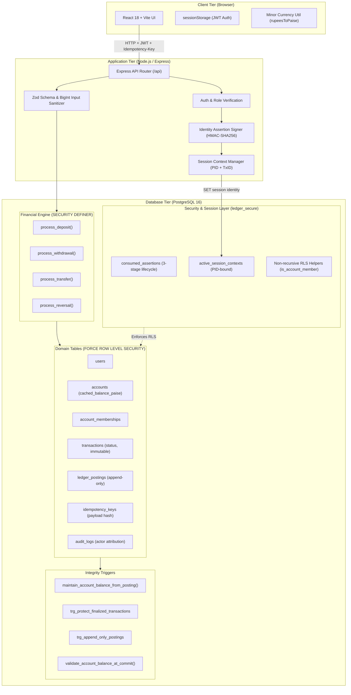
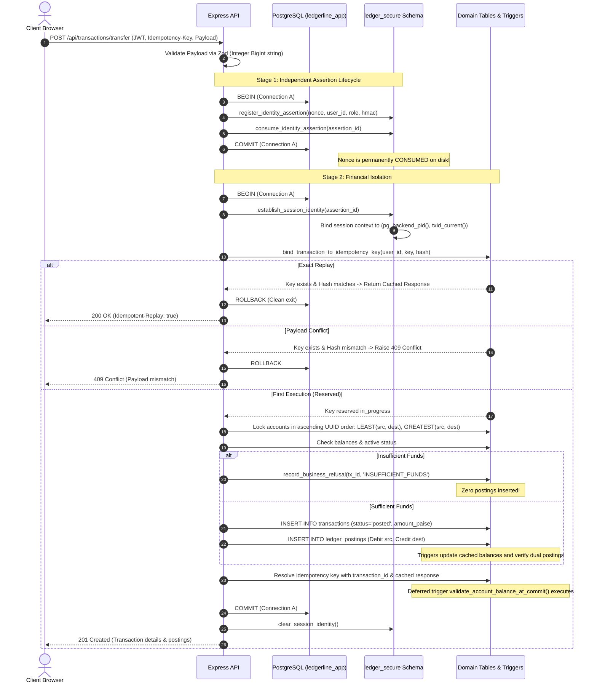

# LedgerLine Core — System Architecture Specification

Version: 1.0.0  
Status: Production Baseline  
Classification: Enterprise Financial Core

---

## 1. Executive Summary & Architectural Tenets

**LedgerLine** is an enterprise-grade financial transaction engine and double-entry ledger designed with **defense-in-depth security** and mathematical correctness. Rather than delegating financial validation solely to application-tier controllers, LedgerLine enforces financial invariants, zero-sum constraints, and authorization policies directly within PostgreSQL database triggers and Row-Level Security (RLS).

### Core Tenets:
1. **Mathematical Invariance**: Binary floating-point numbers are avoided across all monetary tiers. Minor currency units (**integer paise**, `BIGINT`) prevent IEEE 754 precision loss in balance arithmetic (without claiming to eliminate all potential financial calculation defects).
2. **Double-Entry Rigor**: Every posted transaction yields exactly two complementary postings that sum strictly to zero ($\sum \Delta = 0$). Refused transactions yield zero postings.
3. **Database-Enforced Access Control**: PostgreSQL `FORCE ROW LEVEL SECURITY` on all 7 domain tables guarantees that multi-tenant isolation cannot be bypassed even if backend application code contains logic flaws.
4. **Independent Nonce Lifecycle**: Caller cryptographic identity assertions commit independently before financial execution begins, guaranteeing that assertion replay is impossible even if financial transactions roll back.
5. **Deterministic Concurrency**: Multi-account transfers lock participating rows in ascending UUID order, eliminating deadlocks under high-frequency opposing transactions.

---

## 2. Monorepo Structure & Layout

LedgerLine is organized as a unified monorepo:

```
ledgerline-core/
├── client/                     # Frontend Application (React 18 + Vite)
│   ├── src/
│   │   ├── components/         # Reusable UI widgets & modals
│   │   ├── pages/              # Routed pages (Dashboard, Accounts, Admin, Health)
│   │   ├── services/           # API client, error normalization, sessionStorage
│   │   ├── utils/              # Decimal/paise conversion, formatting, UUID v4
│   │   └── App.jsx             # Main router & authentication gates
│   └── test/                   # Client unit & precision test suite (41 tests)
├── database/                   # Database Migrations & Seeds
│   ├── migrations/             # 001 to 009 SQL migrations
│   │   ├── 001_schemas_roles_extensions.sql
│   │   ├── 002_domain_tables.sql
│   │   ├── 003_row_level_security.sql
│   │   ├── 004_integrity_triggers_and_deferred_validator.sql
│   │   ├── 005_identity_assertions_and_session_context.sql
│   │   ├── 006_financial_engine_procedures.sql
│   │   ├── 007_audit_logging.sql
│   │   ├── 008_security_remediations.sql
│   │   └── 009_harden_search_paths_and_schema_privileges.sql
│   └── seeds/                  # Baseline system accounts & seed data
├── server/                     # Backend API Tier (Node.js 20+ / Express)
│   ├── src/
│   │   ├── controllers/        # Express route handlers
│   │   ├── middleware/         # Auth, validation, error handling, rate limiting
│   │   ├── routes/             # REST routing definitions
│   │   ├── services/           # Business services, HMAC assertions, DB pools
│   │   └── db/                 # Migration runner, sessionContext, pool
│   ├── scripts/                # Bootstrap & database verification utilities
│   └── test/                   # Comprehensive integration test suite (62 tests)
├── docs/                       # Architectural & operational documentation
│   ├── API.md                  # RESTful API Reference Manual
│   ├── ARCHITECTURE.md         # This specification document
│   ├── DEPLOYMENT.md           # Production deployment & hardening guide
│   └── DEMO.md                 # 5-minute hackathon runbook & project write-up
├── .github/                    # CI/CD Workflows
│   └── workflows/ci.yml        # Automated test & build validation pipeline
├── PROMPTS.md                  # Traceable prompt and development log
├── README.md                   # Project overview & developer guide
├── SUBMISSION.md               # Hackathon deliverable checklist
└── THREATS.md                  # Comprehensive STRIDE & 17-Scenario Threat Model
```

---

## 3. End-to-End System Architecture



---

## 4. Financial Transaction Lifecycle & Execution Sequence

The complete execution of a financial transfer demonstrates LedgerLine's defense against replay attacks, dirty reads, and concurrency races:



---

## 5. Relational Data Model (7 Core Domain Tables)

All tables reside in schema `public` with `ROW LEVEL SECURITY` activated and `relforcerowsecurity = true`.

### 5.1 `public.users`
Stores system actors and authentication profiles.

- **Columns**:
  - `id` (`uuid`, PK, default: `gen_random_uuid()`)
  - `email` (`text`, UNIQUE, NOT NULL, indexed)
  - `password_hash` (`text`, NOT NULL) — scrypt salt/hash
  - `full_name` (`text`, NOT NULL)
  - `role` (`text`, NOT NULL, CHECK `role IN ('admin', 'auditor', 'customer')`)
  - `status` (`text`, NOT NULL, default: `'active'`, CHECK `status IN ('active', 'suspended')`)
  - `created_at` (`timestamptz`, NOT NULL, default: `clock_timestamp()`)
  - `updated_at` (`timestamptz`, NOT NULL, default: `clock_timestamp()`)
- **RLS Policy**:
  - Admin: Full access.
  - User: Can view own record (`id = current_verified_user_id()`).

### 5.2 `public.accounts`
Stores balance-holding accounts including customer checking/savings and the system vault.

- **Columns**:
  - `id` (`uuid`, PK, default: `gen_random_uuid()`)
  - `account_number` (`text`, UNIQUE, NOT NULL, indexed)
  - `name` (`text`, NOT NULL)
  - `type` (`text`, NOT NULL, CHECK `type IN ('customer', 'vault')`)
  - `currency` (`text`, NOT NULL, default: `'INR'`, CHECK `currency = 'INR'`)
  - `cached_balance_paise` (`bigint`, NOT NULL, default: 0) — strictly maintained by triggers
  - `status` (`text`, NOT NULL, default: `'active'`, CHECK `status IN ('active', 'frozen', 'closed')`)
  - `created_at` (`timestamptz`, NOT NULL, default: `clock_timestamp()`)
- **Check Constraints**:
  - `cached_balance_paise >= 0` for customer accounts (system vault may be negative).
- **RLS Policy**:
  - System accounts accessible to administrators.
  - Customer accounts accessible only to verified members (`is_account_member(id)`).

### 5.3 `public.account_memberships`
Binds users to accounts with specific privileges.

- **Columns**:
  - `id` (`uuid`, PK, default: `gen_random_uuid()`)
  - `account_id` (`uuid`, FK `accounts.id`, NOT NULL)
  - `user_id` (`uuid`, FK `users.id`, NOT NULL)
  - `role` (`text`, NOT NULL, CHECK `role IN ('account_holder', 'auditor')`)
  - `created_at` (`timestamptz`, NOT NULL, default: `clock_timestamp()`)
- **Constraints**:
  - `UNIQUE (account_id, user_id)`
  - Trigger `trg_prevent_zero_holders`: Blocks deletion/revocation if it leaves an active account with 0 account holders.
- **RLS Policy**:
  - Members can read memberships for accounts they belong to.

### 5.4 `public.transactions`
Represents the business intent and final disposition of financial movements.

- **Columns**:
  - `id` (`uuid`, PK, default: `gen_random_uuid()`)
  - `type` (`text`, NOT NULL, CHECK `type IN ('deposit', 'withdrawal', 'transfer', 'reversal')`)
  - `status` (`text`, NOT NULL, CHECK `status IN ('pending', 'posted', 'refused')`)
  - `source_account_id` (`uuid`, FK `accounts.id`, NOT NULL)
  - `destination_account_id` (`uuid`, FK `accounts.id`, NOT NULL)
  - `amount_paise` (`bigint`, NOT NULL, CHECK `amount_paise > 0`)
  - `currency` (`text`, NOT NULL, default: `'INR'`, CHECK `currency = 'INR'`)
  - `description` (`text`)
  - `refusal_reason` (`text`)
  - `created_by` (`uuid`, FK `users.id`, NOT NULL)
  - `created_at` (`timestamptz`, NOT NULL, default: `clock_timestamp()`)
- **Trigger**:
  - `trg_protect_finalized_transactions`: Disallows `UPDATE` or `DELETE` on rows where `status IN ('posted', 'refused')`.
- **RLS Policy**:
  - Readable by transaction creator, source account member, destination account member, or administrator.

### 5.5 `public.ledger_postings`
Append-only immutable debits and credits forming the fundamental source of truth.

- **Columns**:
  - `id` (`uuid`, PK, default: `gen_random_uuid()`)
  - `transaction_id` (`uuid`, FK `transactions.id`, NOT NULL)
  - `account_id` (`uuid`, FK `accounts.id`, NOT NULL)
  - `amount_paise` (`bigint`, NOT NULL, CHECK `amount_paise <> 0`)
  - `direction` (`text`, NOT NULL, CHECK `direction IN ('debit', 'credit')`)
  - `created_at` (`timestamptz`, NOT NULL, default: `clock_timestamp()`)
- **Triggers**:
  - `trg_append_only_postings`: Blocks any `UPDATE` or `DELETE` on this table.
  - `trg_maintain_balance`: Atomically adjusts `accounts.cached_balance_paise`.
  - `trg_prevent_extra_postings`: Blocks adding more than 2 postings per transaction.
- **RLS Policy**:
  - Readable only by verified members of `account_id` or administrators.

### 5.6 `public.idempotency_keys`
Guarantees exactly-once transaction processing and safe replays.

- **Columns**:
  - `id` (`uuid`, PK, default: `gen_random_uuid()`)
  - `user_id` (`uuid`, FK `users.id`, NOT NULL)
  - `key` (`uuid`, NOT NULL)
  - `request_hash` (`text`, NOT NULL) — SHA-256 of canonical JSON payload
  - `transaction_id` (`uuid`, FK `transactions.id`)
  - `status` (`text`, NOT NULL, CHECK `status IN ('in_progress', 'resolved')`)
  - `response_body` (`jsonb`)
  - `response_status` (`integer`)
  - `created_at` (`timestamptz`, NOT NULL, default: `clock_timestamp()`)
- **Constraints**:
  - `UNIQUE (user_id, key)`: Namespaced by user to prevent cross-user key collision or hijacking.
- **RLS Policy**:
  - Users can read/write only their own keys.

### 5.7 `public.audit_logs`
Non-repudiable audit trail for governance and security attribution.

- **Columns**:
  - `id` (`uuid`, PK, default: `gen_random_uuid()`)
  - `actor_id` (`uuid`, FK `users.id`, NOT NULL)
  - `actor_role` (`text`, NOT NULL)
  - `action` (`text`, NOT NULL)
  - `details` (`jsonb`, NOT NULL)
  - `ip_address` (`text`)
  - `created_at` (`timestamptz`, NOT NULL, default: `clock_timestamp()`)
- **Trigger**:
  - `trg_append_only_audit_logs`: Rejects all `UPDATE` and `DELETE` queries.
- **RLS Policy**:
  - Admins can read all logs.

---

## 6. The 9 Financial Invariants & Enforcement Matrix

| # | Financial Invariant | Enforcement Mechanism | Failure Consequence |
| :--- | :--- | :--- | :--- |
| **1** | **Strict Zero-Sum Conservation** ($\sum \text{postings} = 0$) | Trigger `trg_verify_transaction_balance` evaluates at transaction finalize | Transaction commit fails; balance imbalance aborted |
| **2** | **Cached Balance Reconciliation** (`cached_balance == SUM(postings)`) | Deferred trigger `validate_account_balance_at_commit` evaluates at `COMMIT` | Transaction aborts with SQLSTATE `23514` |
| **3** | **Non-Negative Customer Balances** (`balance >= 0`) | CHECK constraint on `accounts.cached_balance_paise` | Rejected at insert time with `23514` check violation |
| **4** | **Double-Entry Cardinality** (Exactly 2 postings per posted transaction) | Trigger `trg_prevent_extra_postings` + commit check | Extra postings blocked; incomplete transactions fail |
| **5** | **Zero-Postings on Refusal** | Procedure logic in `record_business_refusal()` | Refused transactions permanently store 0 postings |
| **6** | **Append-Only Ledger Immutability** | Trigger `trg_append_only_postings` raises exception on `UPDATE`/`DELETE` | Database rejection with `23514` |
| **7** | **Finalized Transaction Immutability** | Trigger `trg_protect_finalized_transactions` raises exception on edit | Modifications to amount, endpoints, or state blocked |
| **8** | **Reversal Cardinality & Restitution** | Procedure `process_reversal()` verifies target status and single reversal | Double reversal rejected with `ALREADY_REVERSED` |
| **9** | **Deterministic Deadlock Prevention** | Two-phase ascending UUID row locking: `LEAST(a, b)` then `GREATEST(a, b)` | Zero concurrency deadlocks under opposing transfers |

---

## 7. Rationale for Integer Minor Currency Units (Paise)

### 7.1 The Floating-Point Hazard in Financial Systems
Standard JavaScript `Number` types use 64-bit IEEE 754 double-precision floating-point numbers. These binary fractions cannot represent decimal fractions precisely:
```javascript
0.1 + 0.2 === 0.3; // FALSE! Evaluates to 0.30000000000000004
10.55 * 100;       // Evaluates to 1054.9999999999998 paise (loss of 1 paisa!)
```
In banking systems processing millions of transactions, cumulative floating-point rounding errors create un-reconcilable ledger deficits and regulatory non-compliance.

### 7.2 LedgerLine Minor Currency Protocol
- **Storage & Engine**: All database columns and backend calculations use PostgreSQL `BIGINT` representing integer paise (₹1 = 100 paise).
- **Transport**: JSON API payloads transmit monetary values as string-encoded integers (e.g. `"150000"` for ₹1,500.00).
- **Client Parsing (`rupeesToPaise`)**: The client parses user rupee input via strict string manipulation:
  1. Validates string format `/^\d+(\.\d{1,2})?$/`.
  2. Splits into integer rupee and fractional paisa strings.
  3. Pads fraction to exactly 2 digits (e.g. `"5"` becomes `"50"`).
  4. Concatenates strings and casts to native `BigInt`: `BigInt(whole + fraction)`.
  5. Never multiplies by `100` via floating-point arithmetic.
